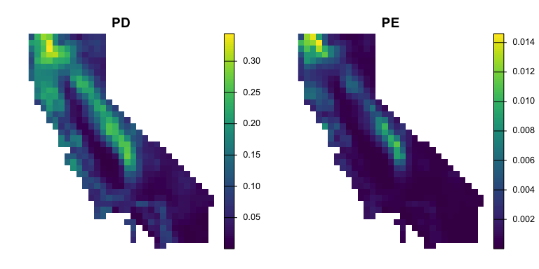
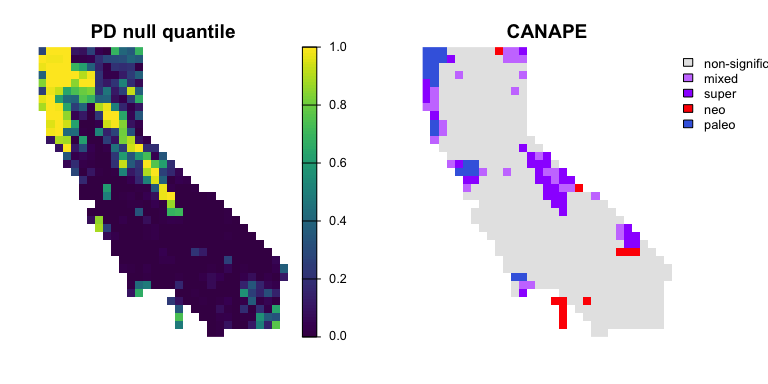
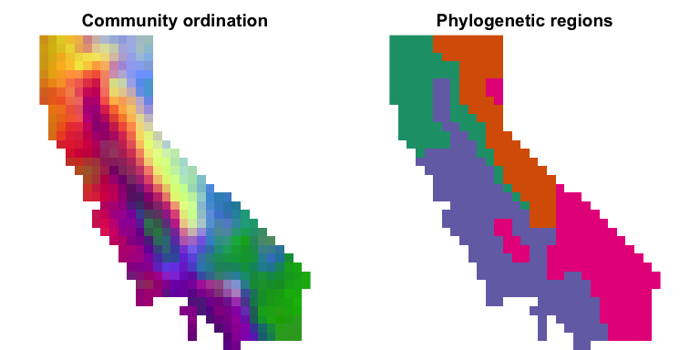
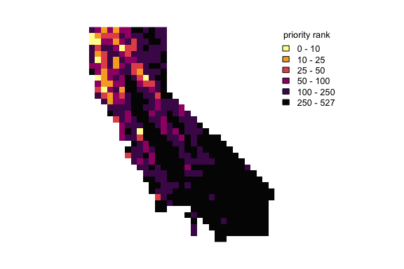

<!-- README.md is generated from README.Rmd. Please edit that file -->

<!-- badges: start -->

[](https://github.com/matthewkling/phylospatial/actions/workflows/R-CMD-check.yaml)
[](https://CRAN.R-project.org/package=phylospatial)
<!-- badges: end -->

# phylospatial <a href="https://matthewkling.github.io/phylospatial/"></a>

`phylospatial` is an R package for spatial phylogenetics: mapping and
analyzing biodiversity in a way that accounts for the evolutionary
relationships among taxa. The package is built around the “phylogenetic
diversity” family of metrics, which count each clade or branch segment
on the phylogeny rather than giving primacy to the terminal species. It
covers the full workflow, from building data sets to mapping diversity
and endemism, testing significance against null models, comparing
communities, delineating bioregions, and setting conservation
priorities. It is designed to be flexible:

- **Any kind of occurrence data.** Binary presence-absence, abundances,
  or continuous occurrence probabilities such as species distribution
  model predictions. Every analysis uses quantitative values directly
  rather than thresholding them, which avoids information loss and
  enables analyses not available in other spatial phylogenetic R
  packages.
- **Any spatial format.** Raster grids (`terra`), polygons or points
  (`sf`), or occurrence records converted to a grid with `ps_grid()`.
  Results come back as maps ready to plot.
- **A wide range of null models.** Randomizations from `vegan` and
  `nullcat` (including stratified algorithms designed for quantitative
  data), custom functions, and spatially constrained null models that
  test whether sites are unusual relative to their neighbors.
- **Not just for phylogenies.** Leave out the tree and the same tools
  perform conventional, non-phylogenetic analyses of richness, endemism,
  beta diversity, bioregions, and conservation priorities. Or supply
  another kind of tree, such as a taxonomic hierarchy or a functional
  trait dendrogram.

## Installation

``` r
# install the package from CRAN:
install.packages("phylospatial")

# or the development version from GitHub:
remotes::install_github("matthewkling/phylospatial")
```

## Building a data set

Analyses start from a `phylospatial` object, created by `phylospatial()`
from a community data set (a `SpatRaster` or `sf` object with a layer or
column per taxon, or a site-by-taxon matrix) and a phylogeny. If your
data are occurrence points, `ps_grid()` converts them to a raster data
set first. The package includes an example data set of occurrence
probabilities for 443 moss species across California, along with their
phylogeny, which we’ll use here:

``` r
library(phylospatial)
library(terra)

ps <- moss()
ps
#> `phylospatial` object
#>   - 884 lineages across 527 occupied sites (1116 total) 
#>   - community data type: probability 
#>   - branch length rescaling: sum1 
#>   - site weights: equal 
#>   - spatial data class: SpatRaster 
#>   - dissimilarity data: none
```

See `vignette("phylospatial-data")` for details on constructing data
sets.

## Alpha diversity

`ps_diversity()` calculates a suite of richness, divergence, and
regularity metrics, including phylogenetic diversity (PD) and
phylogenetic endemism (PE):

``` r
div <- ps_diversity(ps, metric = c("PD", "PE"))
plot(div, axes = FALSE)
```



`ps_rand()` tests these metrics against a null model, and `ps_canape()`
uses the results to classify sites into centers of neo- and
paleo-endemism (CANAPE). There are a range of null model algorithms
available for different hypotheses and data types; see
`vignette("alpha-diversity")` for details. Here’s a quick version with
1000 randomizations and a modest number of burn-in iterations. Adding
`site_groups = ps_tile_groups(...)` would make the null model spatially
constrained, comparing each site only to its surroundings rather than to
the whole study area.

``` r
rand <- ps_rand(ps, metric = c("PD", "PE", "CE", "RPE"), n_rand = 1000,
                fun = "quantize", method = "curvecat",
                transform = function(x) log10(x + 0.001),
                n_iter = 30000, n_cores = 8, progress = FALSE)

par(mfrow = c(1, 2))
plot(rand$qPD, axes = FALSE, main = "PD null quantile")

canape <- ps_canape(rand)
plot(canape, axes = FALSE, main = "CANAPE")
```



## Beta diversity

`ps_dissim()` computes various measures of phylogenetic dissimilarity
between sites, with options to partition it into turnover and
nestedness, weight lineages by endemism, and compare a focal site to
every other site (`ps_dissim_focal()`) or each site to itself in another
data set (`ps_dissim_paired()`, for example to measure change over
time). Dissimilarities feed into ordination (`ps_ordinate()`,
`ps_rgb()`) and bioregionalization (`ps_regions()`), and can be used in
a wide range of analyses such as GDM and PERMANOVA tests. Here, sites
with similar colors on the left have similar lineage composition, and
the map on the right groups sites into four phylogenetic regions:

``` r
ps <- ps_add_dissim(ps, method = "sorensen", endemism = TRUE, normalize = TRUE)
rgb <- ps_rgb(ps, method = "cmds")
regions <- ps_regions(ps, k = 4, method = "average")

par(mfrow = c(1, 2))
plotRGB(rgb, scale = 1, smooth = FALSE, mar = c(0, 0, 2, 0),
        main = "Community ordination")
plot(regions, type = "classes", col = palette.colors(4, "Dark 2"), legend = FALSE,
     axes = FALSE, mar = c(0, 0, 2, 0), main = "Phylogenetic regions")
```



See `vignette("beta-diversity")` for more.

## Conservation prioritization

The package includes two approaches for computing optimal reserve
networks that protect evolutionary diversity while accounting for
existing protected areas, the cost of protection, and complementarity
among sites: `ps_prioritize()` finds a nested ranking of sites, while
`ps_prioritizr()` sets up a [prioritizr](https://prioritizr.net) problem
that finds optimal solutions for a given budget or target.
`ps_performance()` traces how conservation value accumulates along the
ranking. Here, low ranks (yellow) are the highest priorities for
expanding California’s protected areas to conserve moss lineages:

``` r
protection <- moss(data = "protection") # existing protection level of each site
cost <- 1 + log1p(moss(data = "popdens")) # population density as a proxy for cost
priority <- ps_prioritize(ps, init = protection, cost = cost, progress = FALSE)

rank_breaks <- c(0, 10, 25, 50, 100, 250, global(priority, "max", na.rm = TRUE)[[1]])
plot(priority, breaks = rank_breaks, col = rev(hcl.colors(6, "inferno")),
     axes = FALSE, plg = list(title = "priority rank"))
```



## Learn more

The [package website](https://matthewkling.github.io/phylospatial/) has
full documentation and four vignettes:

- `vignette("phylospatial-data")`: constructing `phylospatial` data sets
  from different types of data.
- `vignette("alpha-diversity")`: alpha diversity and endemism metrics,
  null model randomization, and CANAPE.
- `vignette("beta-diversity")`: phylogenetic dissimilarity, ordination,
  and regionalization.
- `vignette("prioritization")`: conservation prioritization with
  `ps_prioritize()` and `ps_prioritizr()`.

## Citation

To cite `phylospatial` in publications, please use:

> Kling, M. (2025). phylospatial: an R package for spatial phylogenetic
> analysis with quantitative community data. Methods in Ecology and
> Evolution 16:1075–1083. DOI 10.1111/2041-210x.70056
