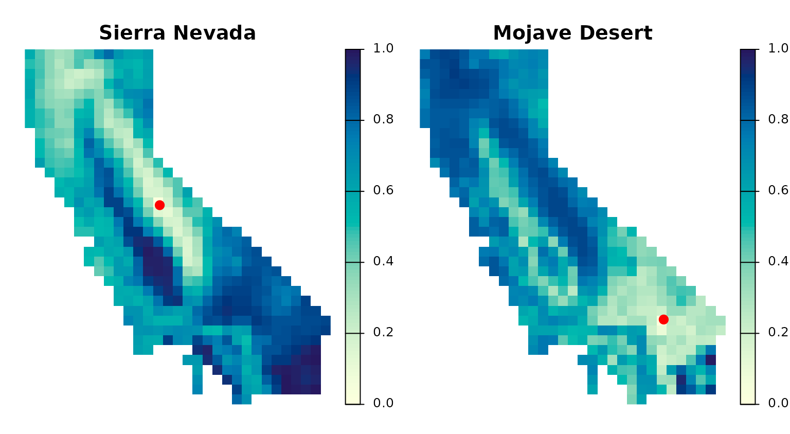
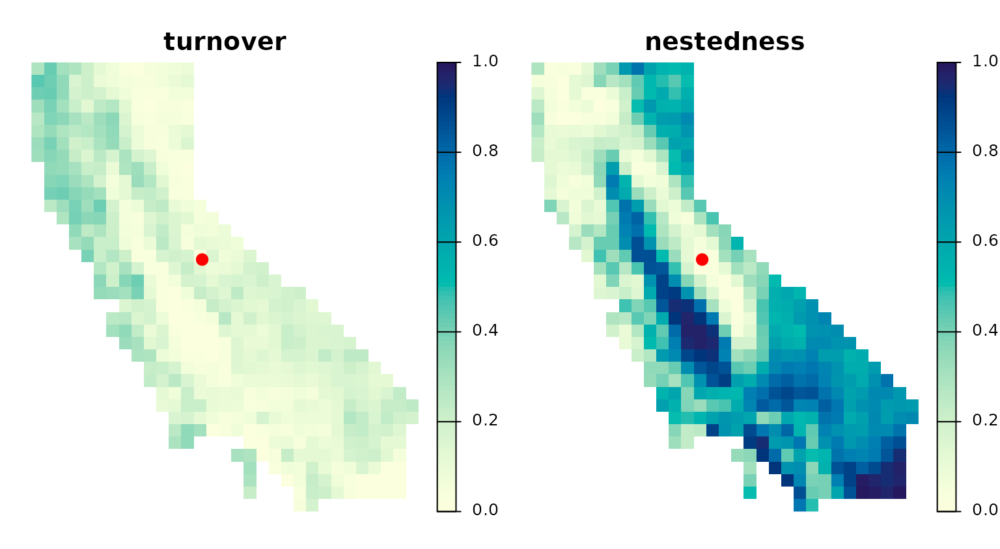
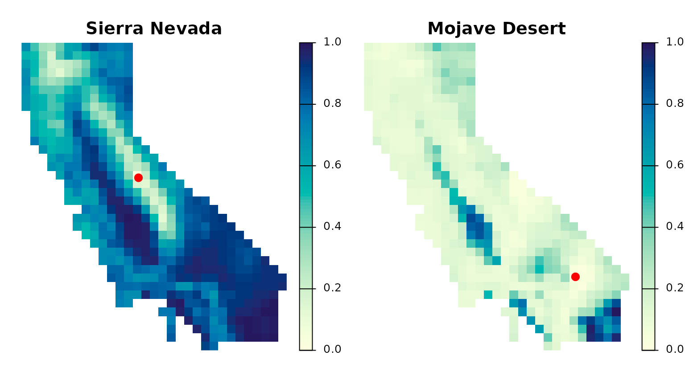
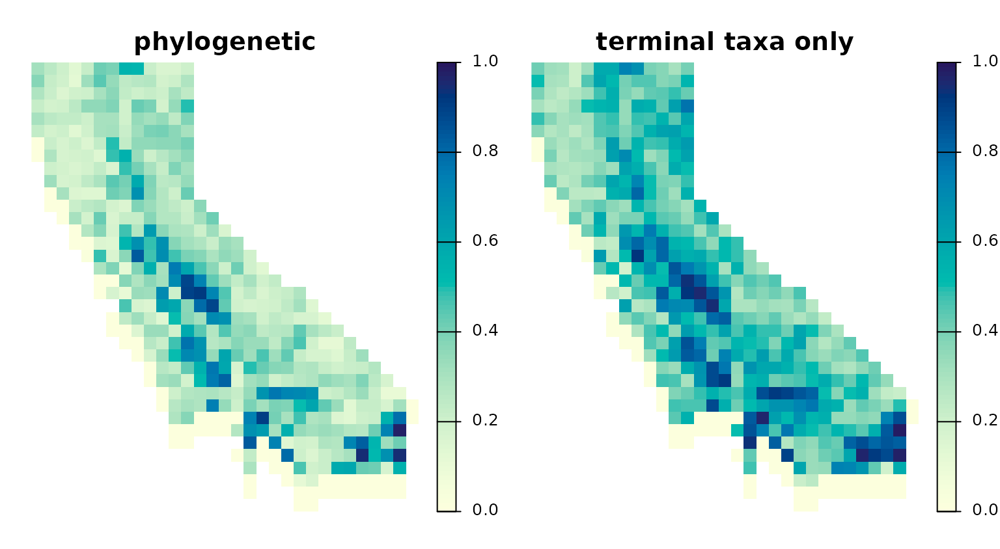
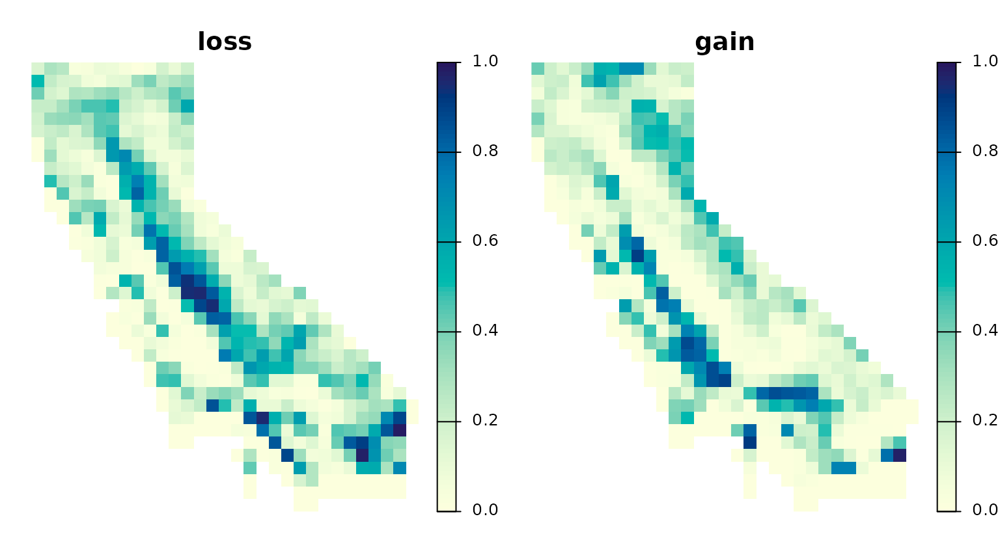
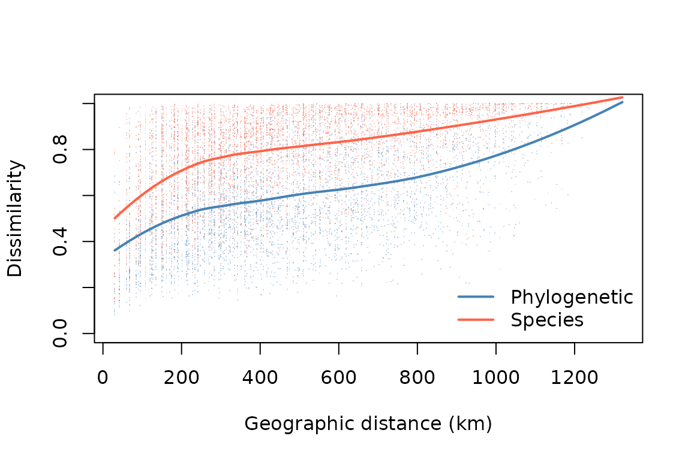
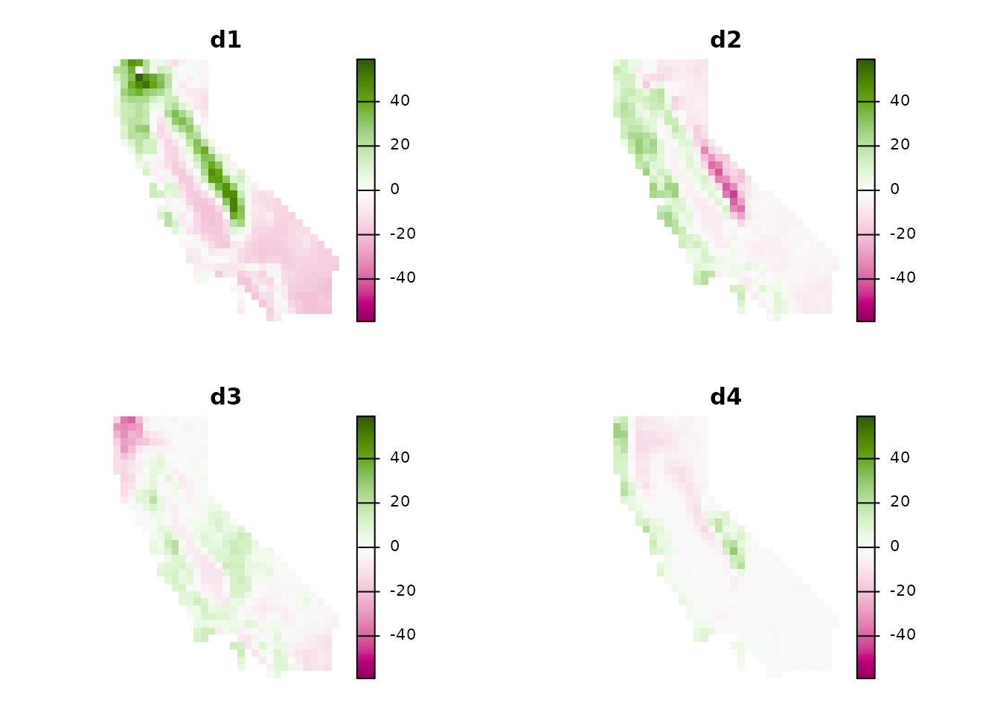
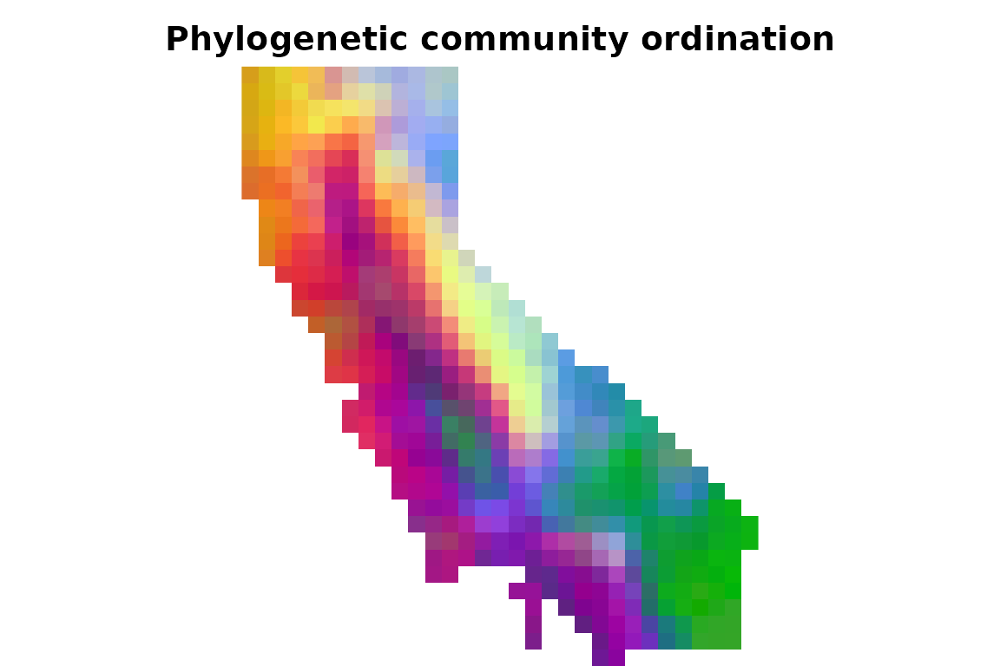
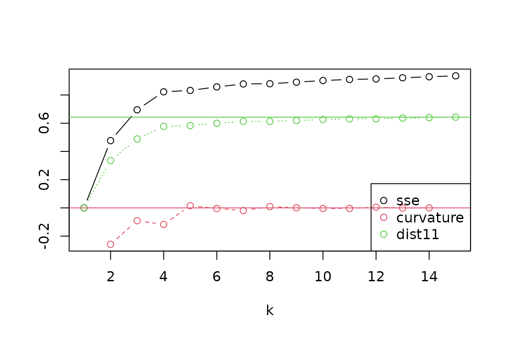
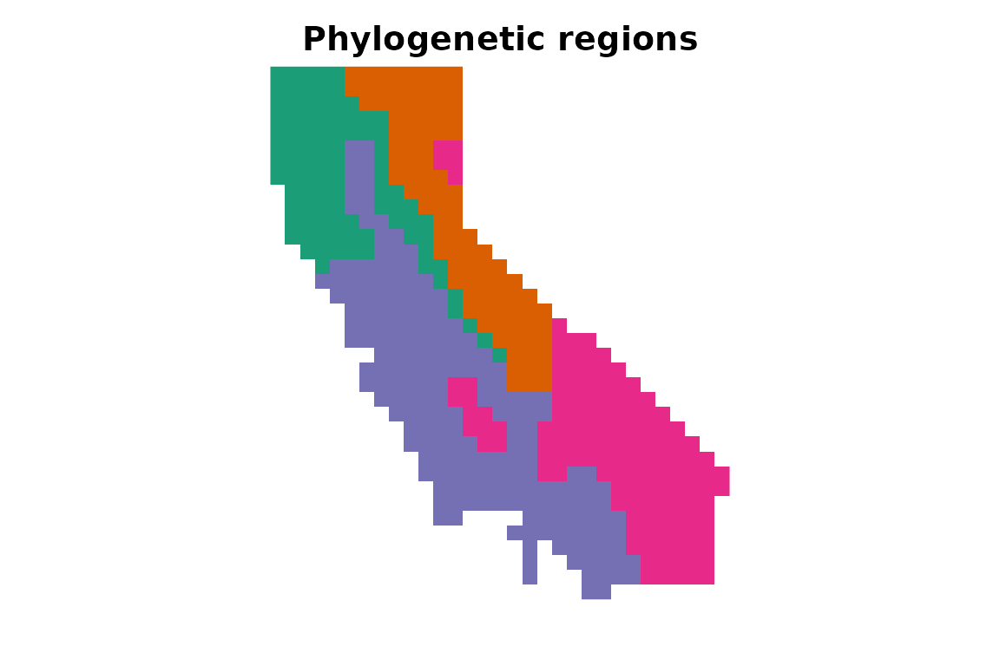

# Phylogenetic beta diversity

This vignette covers topics related to phylogenetic beta diversity,
including calculation of pairwise dissimilarity between sites, mapping
dissimilarity from focal sites, comparing two data sets for the same
sites, and use of these dissimilarity values in distance decay,
ordination, and regionalization analyses.

To get started, let’s load the `phylospatial` library, as well as
`terra` for visualization. Note that the functions covered here all
require a `phylospatial` object as input; see
[`vignette("phylospatial-data")`](https://matthewkling.github.io/phylospatial/articles/phylospatial-data.md)
for details on constructing data sets. We’ll use the
[`moss()`](https://matthewkling.github.io/phylospatial/reference/moss.md)
example data here.

``` r

library(phylospatial); library(terra)
ps <- moss()
```

## Dissimilarity

The `phylospatial` package provides a range of methods for calculating
pairwise community phylogenetic distances among locations. It can
calculate phylogenetic versions of (almost) any quantitative community
dissimilarity metric available trough the `vegan` package, including the
various predefined indices provided through
[`vegan::vegdist`](https://vegandevs.github.io/vegan/reference/vegdist.html)
as well as custom indices specified through
[`vegan::designdist`](https://vegandevs.github.io/vegan/reference/designdist.html).
The default metric is Bray-Curtis distance, also known as quantitative
Sorensen’s dissimilarity. Additional choices allow for partitioning
dissimilarity in to turnover and nestedness components.

Dissimilarity is computed using the function
[`ps_add_dissim()`](https://matthewkling.github.io/phylospatial/reference/ps_add_dissim.md),
which adds a distance matrix to the `dissim` slot of your `phylospatial`
data set. Or if you just want the matrix itself, you can use
[`ps_dissim()`](https://matthewkling.github.io/phylospatial/reference/ps_dissim.md).

In addition to specifying the dissimilarity index to use, these
functions include options for different ways to scale the phylogenetic
community matrix before calculating dissimilarity. Setting
`endemism = TRUE` will scale every lineage’s occurrence values to sum to
1 across all sites, giving greater weight to narrowly distributed taxa.
Setting `normalize = TRUE` scales every site’s total occurrence value to
sum to 1 across taxa, which results in a distance matrix that emphasizes
proportional differences in composition rather than alpha diversity
gradients.

Let’s run an example using quantitative Sorensen’s index, weighted by
endemism. Printing the result, we can see it now contains dissimilarity
data; this is a square distance matrix with a row and column for each
site:

``` r

ps <- ps_add_dissim(ps, method = "sorensen", endemism = TRUE, normalize = TRUE)
ps
#> `phylospatial` object
#>   - 884 lineages across 527 occupied sites (1116 total) 
#>   - community data type: probability 
#>   - branch length rescaling: sum1 
#>   - site weights: equal 
#>   - spatial data class: SpatRaster 
#>   - dissimilarity data: sorensen
```

## Focal site dissimilarity

A full dissimilarity matrix is hard to inspect directly, since it
contains a value for every pair of sites. One intuitive way to explore
it is to choose a focal site and map its dissimilarity to every other
site, showing where on the landscape similar lineage assemblages recur.
The function
[`ps_dissim_focal()`](https://matthewkling.github.io/phylospatial/reference/ps_dissim_focal.md)
does this. It accepts the same `method` and scaling options as
[`ps_dissim()`](https://matthewkling.github.io/phylospatial/reference/ps_dissim.md),
and gives the same values as the corresponding row of the full matrix;
for the Sorensen family and for custom `designdist` formulas it computes
only the focal rows, so it stays fast even for large data sets, while
other `vegdist` indices compute the full matrix and keep the relevant
rows. Note that it computes dissimilarity from its own arguments, rather
than reusing the matrix stored by
[`ps_add_dissim()`](https://matthewkling.github.io/phylospatial/reference/ps_add_dissim.md).

Focal sites can be given as site indices, as a two-column matrix of
coordinates in the coordinate system of the data set, or as `sf` or
`SpatVector` points, which are reprojected as needed. Let’s compare two
focal sites with very different moss floras, one in the Sierra Nevada
and one in the Mojave Desert, specified by longitude and latitude. We’ll
also write a small mapping function for this section, which draws one
panel per layer, on a common color scale, with the focal site marked in
red:

``` r

focal <- sf::st_as_sf(data.frame(site = c("Sierra Nevada", "Mojave Desert"),
                                 lon = c(-119.6, -116), lat = c(37.8, 34.6)),
                      coords = c("lon", "lat"), crs = 4326)
focal$site <- factor(focal$site, levels = focal$site) # keep panels in this order

map_focal <- function(r, pts){
      pts <- project(vect(pts), crs(r))
      plot(r, col = hcl.colors(100, "YlGnBu", rev = TRUE), range = c(0, 1),
           nc = nlyr(r), axes = FALSE,
           # with several focal sites, show each site's point only in its own panel
           fun = function(i) points(pts[min(i, nrow(pts))], col = "red", pch = 19, cex = 1.2))
}

fd <- ps_dissim_focal(ps, focal, method = "sorensen")
names(fd) <- levels(focal$site)
map_focal(fd, focal)
```



Dissimilarity is zero at each focal site and generally rises with
distance, but not uniformly. The Sierra Nevada site is more similar to
the distant mountains of northern California than to the nearby Central
Valley, and most dissimilar from the southern deserts. The desert site
shows the reverse pattern, resembling the southeastern deserts and parts
of the southern coast ranges while differing strongly from the Sierra
Nevada and the north. Patterns like these show which parts of the
landscape share a site’s evolutionary history, and how sharply
composition changes along environmental gradients.

As with
[`ps_dissim()`](https://matthewkling.github.io/phylospatial/reference/ps_dissim.md),
Sorensen’s dissimilarity can be partitioned into turnover and nestedness
components. The turnover component reflects replacement of lineages by
different lineages, while the nestedness component reflects sites
holding subsets of one another’s lineages. Let’s map both for the Sierra
Nevada site:

``` r

fp <- c(ps_dissim_focal(ps, focal[1, ], method = "sorensen_turnover"),
        ps_dissim_focal(ps, focal[1, ], method = "sorensen_nestedness"))
names(fp) <- c("turnover", "nestedness")
map_focal(fp, focal[1, ])
```



Most of this site’s dissimilarity from the rest of the state is due to
nestedness: the site is rich in lineages, and other sites mostly hold
subsets of them. Turnover, the replacement of its lineages by others, is
modest everywhere.

[`ps_dissim_focal()`](https://matthewkling.github.io/phylospatial/reference/ps_dissim_focal.md)
also offers one index that isn’t available in
[`ps_dissim()`](https://matthewkling.github.io/phylospatial/reference/ps_dissim.md):
`method = "focal_difference"`, the fraction of the focal site’s branch
length that is absent from each other site. Unlike symmetric indices, it
ignores lineages found only at the other site, so a lineage-rich site
that contains all of the focal site’s lineages has a value of zero.
Because it has a direction, it is only defined relative to a focal site.
It is the complement of a phylogenetic, quantitative version of a
dispersion field (Graves & Rahbek 2005, *PNAS* 102:7871-7876), the
overlapping ranges of all lineages present at the focal site. Let’s map
it for both focal sites, for comparison with Sorensen’s dissimilarity
above:

``` r

fdiff <- ps_dissim_focal(ps, focal, method = "focal_difference")
names(fdiff) <- levels(focal$site)
map_focal(fdiff, focal)
```



For the lineage-rich Sierra Nevada site, `focal_difference` looks much
like Sorensen’s dissimilarity in the earlier plot, since sites that
differ from it mostly do so by lacking its lineages. For the desert
site, the two indices tell very different stories. Sorensen’s index in
the earlier figure rates the lineage-rich northern mountains as highly
dissimilar, because they hold many lineages the desert site lacks. But
here, `focal_difference` shows that the desert site’s own lineages occur
nearly everywhere: its assemblage is largely a subset of the state’s
moss flora, and its lineages are missing mainly from parts of the
Central Valley and the far southeastern deserts.

## Paired dissimilarity

The functions above compare different sites within one data set. A
related question is how lineage composition differs between two data
sets for the same sites: how assemblages change between time periods,
for example, or how modeled communities differ from observed ones. The
function
[`ps_dissim_paired()`](https://matthewkling.github.io/phylospatial/reference/ps_dissim_paired.md)
compares each site in one `phylospatial` object to the same site in
another, returning a map of dissimilarity. It accepts the same `method`
and scaling options as
[`ps_dissim()`](https://matthewkling.github.io/phylospatial/reference/ps_dissim.md),
with a few exceptions noted in its documentation.

To illustrate, let’s construct a hypothetical future moss flora in which
every lineage’s range shifts 60 km north, and the 20 lineages with the
smallest ranges go extinct in this region. Where no cell lies to the
south to supply incoming lineages, we’ll keep the original community:

``` r

comm1 <- ps_get_comm(ps)
comm2 <- shift(comm1, dy = 60000)          # shift ranges 60 km north
comm2 <- crop(extend(comm2, comm1), comm1) # back onto the original grid
comm2 <- cover(comm2, comm1)               # keep original communities where nothing shifts in
comm2 <- mask(comm2, comm1[[1]])           # restrict to the study area

range_size <- terra::global(comm1, "sum", na.rm = TRUE)[, 1]
extinct <- order(range_size)[1:20]
comm2[[extinct]] <- comm2[[extinct]] * 0

ps2 <- phylospatial(comm2, ps$tree)
```

Because
[`phylospatial()`](https://matthewkling.github.io/phylospatial/reference/phylospatial.md)
drops taxa with no occurrences, the regionally-extinct lineages are
dropped from the new data set (with a warning), so its tree differs from
the original one. This will be common with real data, whenever a taxon
is absent from one of the two data sets. To compare data sets like
these, we supply the phylogeny used to build both of them as `tree`, and
[`ps_dissim_paired()`](https://matthewkling.github.io/phylospatial/reference/ps_dissim_paired.md)
aligns them on it, giving the same result as if the absent taxa had been
kept with zero occurrences. (Without `tree`, data sets with different
trees give an error.)

Let’s map Sorensen’s dissimilarity between the two time periods, along
with its non-phylogenetic counterpart based only on terminal taxa:

``` r

map_change <- function(r){
      plot(r, col = hcl.colors(100, "YlGnBu", rev = TRUE), range = c(0, 1),
           nc = nlyr(r), axes = FALSE)
}

chg <- c(ps_dissim_paired(ps, ps2, tree = ps$tree),
         ps_dissim_paired(ps, ps2, tree = ps$tree, tips_only = TRUE))
names(chg) <- c("phylogenetic", "terminal taxa only")
map_change(chg)
```



Change is greatest where composition varies most from south to north, so
that the community just to the south differs most from the local one;
sites along the southern border are unchanged by construction.
Phylogenetic dissimilarity is lower than its non-phylogenetic
counterpart nearly everywhere. Many of the lineages arriving at a site
are close relatives of the ones leaving it, sharing much of their branch
length, so evolutionary history changes less than species composition
does.

A symmetric index like Sorensen’s says how much a site changes, but not
in which direction.
[`ps_dissim_paired()`](https://matthewkling.github.io/phylospatial/reference/ps_dissim_paired.md)
also offers two asymmetric indices for this: `method = "loss"`, the
fraction of a site’s branch length in the first data set that is absent
from the second, and `method = "gain"`, the fraction of its branch
length in the second data set that is absent from the first. As with the
other quantitative indices, for probability or abundance data these
include declines and increases in lineages present at both times, not
only local losses and arrivals.

``` r

dirn <- c(ps_dissim_paired(ps, ps2, method = "loss", tree = ps$tree),
          ps_dissim_paired(ps, ps2, method = "gain", tree = ps$tree))
names(dirn) <- c("loss", "gain")
map_change(dirn)
```



Loss and gain peak in different places. High loss marks sites where a
lineage-rich community is replaced by a poorer one from the south, so
the site loses much of its branch length while gaining little; high gain
marks the reverse, where a site receives a richer community than the one
it had. The overall change in the previous figure thus combines two
different processes in different parts of the state.

Setting `endemism = TRUE` weights lineages by their range sizes, as in
[`ps_dissim()`](https://matthewkling.github.io/phylospatial/reference/ps_dissim.md).
By default,
[`ps_dissim_paired()`](https://matthewkling.github.io/phylospatial/reference/ps_dissim_paired.md)
uses each lineage’s combined range across both data sets, so that both
are weighted on a common scale; the `ranges` argument offers
alternatives, such as treating the first data set as a baseline.

## Distance decay

One frequent use of pairwise dissimilarity matrices is to analyze how
commmunity phylogentic similarity declines with geographic distance,
environmental difference, or other geographic properties. Common methods
for this kind of analysis include generalized dissimilarity modeling and
partial Mantel tests.

Here let’s just visualize how phylogenetic turnover changes with the
distance between sites. We can compute a pairwise geographic distance
matrix using
[`ps_geodist()`](https://matthewkling.github.io/phylospatial/reference/ps_geodist.md).
Let’s also compare this to non-phylogenetic species turnover, which we
can compute by specifying `tips_only = TRUE`. We can summarize the
pattern with a LOESS curve:

``` r

phy_beta <- as.vector(ps_dissim(ps, method = "sorensen"))
spp_beta <- as.vector(ps_dissim(ps, method = "sorensen", tips_only = TRUE))
geo_dist <- as.vector(ps_geodist(ps)) / 1000  # convert to km

# subsample for plotting (full pairwise set is huge)
ss <- sample(length(phy_beta), 5000)

plot(geo_dist[ss], phy_beta[ss],
     pch = ".", col = adjustcolor("steelblue", 0.3),
     xlab = "Geographic distance (km)",
     ylab = "Dissimilarity",
     ylim = c(0, 1))
points(geo_dist[ss], spp_beta[ss],
       pch = ".", col = adjustcolor("tomato", 0.3))
 
# loess trend lines
lo_phy <- loess(phy_beta[ss] ~ geo_dist[ss])
lo_spp <- loess(spp_beta[ss] ~ geo_dist[ss])
ox <- order(geo_dist[ss])
lines(geo_dist[ss][ox], predict(lo_phy)[ox], col = "steelblue", lwd = 2)
lines(geo_dist[ss][ox], predict(lo_spp)[ox], col = "tomato", lwd = 2)
 
legend("bottomright",
       legend = c("Phylogenetic", "Species"),
       col = c("steelblue", "tomato"),
       lwd = 2, bty = "n")
```



## Ordination

Additional approaches for assessing spatial turnover patterns include
ordination or clustering, both of which reduce a dissimilarity matrix
into a lower-dimensional summary. Ordination, which is implemented in
the function
[`ps_ordinate()`](https://matthewkling.github.io/phylospatial/reference/ps_ordinate.md),
identifies the dominant axes of variation in phylogenetic turnover,
which can then be used for visualization or analysis. The funtion offers
various ordination methods. Let’s perform a PCA, and make maps of the
first four dimensions:

``` r

ord <- ps_ordinate(ps, method = "pca", k = 4)
lim <- max(abs(minmax(ord)))  # common, symmetric color scale for all axes
plot(ord, col = hcl.colors(100, "PiYG"), range = c(-lim, lim), axes = FALSE)
```



We can also qualitatively visualize compositional patterns by converting
ordination axes to a set of colors representing how similar two sites
are to each other, using the
[`ps_rgb()`](https://matthewkling.github.io/phylospatial/reference/ps_rgb.md)
function. Let’s do that here, using the `"cmds"` (classical
multidimensional scaling) ordination algorithm, and then plot the result
using
[`terra::plotRGB()`](https://rspatial.github.io/terra/reference/plotRGB.html):

``` r

rgb <- ps_rgb(ps, method = "cmds")
plotRGB(rgb, scale = 1, smooth = FALSE, mar = c(0, 0, 2, 0),
        main = "Phylogenetic community ordination")
```



## Regionalization

We can also perform a more formal cluster analysis that splits the
landscape into a set of evolutionary bioregions, using the
[`ps_regions()`](https://matthewkling.github.io/phylospatial/reference/ps_regions.md)
function. To do this, we need to specify the clustering `method` and the
number of clusters (`k`). Choices of method include k-means and various
hierarchical clustering methods; note that results are sometimes highly
sensitive to which method is selected. The hierarchical methods require
a dissimilarity matrix calculated by first running
[`ps_add_dissim()`](https://matthewkling.github.io/phylospatial/reference/ps_add_dissim.md),
while k-means does not.

Choosing `k` is usually subjective. Many alternative methods have been
proposed in the literature to identify the “optimal” number of clusters
in a data set, but ecological data are often inherently characterized by
continuous gradients rather than discrete provinces, in which case no
value of `k` may clearly fit best. You can use the function
[`ps_regions_eval()`](https://matthewkling.github.io/phylospatial/reference/ps_regions_eval.md)
to help evaluate how well different choices for `k` fit the data by
comparing the variance explained by different numbers of clusters. Let’s
do that here, using the `"average"` hierarchical clustering method:

``` r

ps_regions_eval(ps, k = 1:15, plot = TRUE, method = "average")
```

 From the evaluation plot,
it looks like a value of `k = 4` stands out as the most distinct “elbow”
in explained variance (“SSE”), with near-maximum distance to the 1:1
line (“dist11”), and with more negative “curvature” than its neighbors,
though other choices could also be reasonable. Let’s generate results
for four regions, and then make a map of these zones:

``` r

regions <- ps_regions(ps, k = 4, method = "average")
plot(regions, type = "classes", col = palette.colors(4, "Dark 2"), legend = FALSE,
     axes = FALSE, main = "Phylogenetic regions")
```


