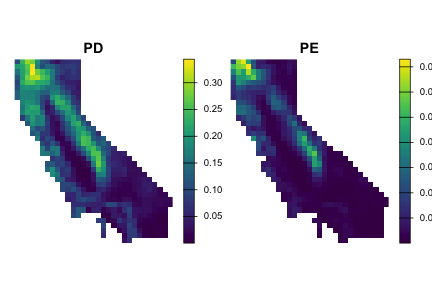
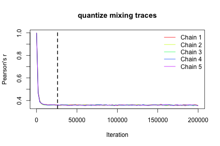
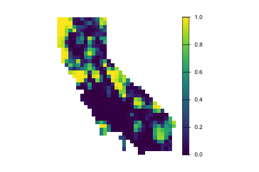
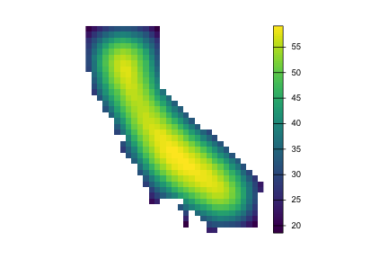
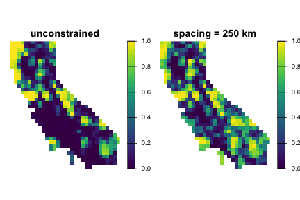
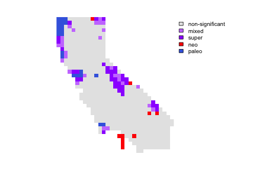

<!--
  =====================================================================
  WARNING: THIS FILE IS GENERATED by rawvignette. Do not edit by hand.
  Source: vignettes-raw/alpha-diversity.Rmd
  Regenerate with: rawvignette::precompile_raw_vignettes()
  =====================================================================
-->
  


This vignette covers topics related to alpha diversity and endemism, including calculation of basic diversity metrics as well as statistical significance testing using null randomization.

To get started, let's load the `phylospatial` library, as well as `terra` for visualization. Note that the functions covered here all require a `phylospatial` object as input; see `vignette("phylospatial-data")` for details on constructing data sets. We'll use the `moss()` example data here.


``` r
library(phylospatial); library(terra)
ps <- moss()
```


## Diversity measures

The `ps_diversity()` function calculates the following alpha diversity measures. While there are a wide variety of phylogentically-informed diversity metrics in the literature, the `phylospatial` package focuses primarily on "node-based" diversity metrics like Faith's PD that give equal treatment to clades/branches at all levels. Phylogenetic diversity metrics can be categorized as addressing richness, divergence, and regularity (Tucker et al. 2017), as listed below. Note that an alternative approach to assessing divergence is through null model analysis of richness metrics, discussed later in this vignette.

Richness metrics:

* PD: Phylogenetic diversity, i.e. total length of all branch segments present in a location
* PE: Phylogenetic endemism, i.e. endemism-weighted PD
* ShPD: Shannon's pylogenetic diversity, a.k.a "phylogenetic entropy"
* ShPE: Shannon's pylogenetic diversity, weighted by endemism
* SiPD: Simpson's phylogenetic diversity
* SiPE: Simpson's phylogenetic diversity, weighted by endemism
* TR: Terminal richness, i.e. richness of terminal taxa (in many cases these are species). For binary data this is the total number of terminals in a site, while for quantitative data it is the sum of probability or abundance values. 
* TE: Terminal endemism, i.e. total endemism-weighted diversity of terminal taxa (a.k.a. "weighted endemism")
* CR: Clade richness, i.e. richness of taxa at all levels (equivalent to PD on a cladogram)
* CE: Clade endemism, i.e. total endemism-weighted diversity of taxa at all levels (equivalent to PE on a cladrogram)

Divergence metrics:

* RPD: Relative phylogenetic diversity, i.e. mean branch segment length of residents (equivalent to PD / CR)
* RPE: Relative phylogenetic endemism, i.e. mean endemism-weighted branch length (equivalent to PE / CE)
* MPDT: Mean pairwise distance between terminals, i.e. the classic MPD measure
* MPDN: Mean pairwise distance between nodes, a node-based version of MPD that calculates the average branch length separating all pairs of collateral (non-lineal) nodes including terminals and internal nodes, giving more representation to deeper branches

Regularity metrics:

* VPDT: Variance in pairwise distances between terminals
* VPDN: Variance in pairwise distances between collateral nodes

All measures use quantitative community data if provided. "Endemism" is the inverse of the total occurrence mass (the sum of presence, probability, or abundance values) across all sites in the analysis. See `?ps_diversity` for equations giving the derivation of each metric.

Let's compute some diversity metrics for our phylospatial data set. Since our data is raster-based, by default the function will return a `SpatRaster` with a layer for each measure. Here we'll make plots of PD and PE:


``` r
div <- ps_diversity(ps, metric = c("PD", "PE"))
plot(div, axes = FALSE)
```




## Null model randomization

We can also use randomization to calculate the statistical significance of these diversity metrics under a null model, using the `ps_rand()` function. `phylospatial` supports a wide range of randomization schemes via the `vegan` and `nullcat` libraries. Here let's run our randomization using `quantize`, a stratified randomization scheme designed for use with continuous occurrence data, in combination with a null model algorithm called `"curvecat"`, which is a categorical version of the "curveball" algorithm that holds marginal row and column multisets fixed.

`quantize` works by binning the occurrence values into strata, randomizing the strata with the categorical null model, and then reassigning the original values. By default it uses five equal-width strata, but occurrence probabilities from species distribution models, like the moss data, are often highly skewed: here the median value is about 0.0000002. Equal-width strata would put 90% of the values in the lowest stratum, and sites whose values all fall in that stratum could not be randomized at all. A log transform with a small floor gives more balanced strata, treating probabilities below about 0.001 as effectively absent, so we'll pass this `transform` to all of our randomizations.

This is a "sequential" (Markov chain) randomization algorithm and thus requires sufficient iterations to reach stationarity, so before running our randomizations, we need to decide how many iterations to run each randomization for. To get an estimate of how many iterations are necessary for convergence based on our particular data and algorithm choice, we can call `ps_suggest_n_iter()` (importantly, using all the same parameters we plan to use for `ps_rand()`):


``` r
tf <- function(x) log10(x + 0.001)
set.seed(123)
iters <- ps_suggest_n_iter(
      ps, fun = "quantize", method = "curvecat", transform = tf,
      n_iter = 2e5, plot = TRUE)
```



This suggests we need around 30,000 iterations for our matrix to mix sufficiently, so we'll pass that value to `ps_rand()`. Let's generate a null distribution of `n_rand = 1000` randomized matrices against which to compare our actual data; we can use parallelization to speed things up by setting `n_cores`. Then we'll plot the results for PE. This is a quantile value that gives the proportion of randomizations in which observed PE was greater than randomized PE in a given grid cell (plus half the proportion of randomizations where observed PE exactly equals the randomized value). If you wanted to identify "statistically significant" grid cells in a one-tailed test with alpha = 0.05, these would be cells with quantile values greater than 0.95.


``` r
rand <- ps_rand(ps, n_rand = 1000,
                metric = c("PD", "PE", "CE", "RPE"),
                fun = "quantize", method = "curvecat", transform = tf,
                n_iter = iters, n_cores = 8, progress = FALSE)
plot(rand$qPE, axes = FALSE)
```



There are numerous alternative options for randomization algorithms, a choice that will depend on the type of occurrence data you have (probability, binary, or abundance) and on which attributes of the terminal community matrix (fill, row and column sums, etc.) you want to hold fixed. In addition to the `"quantize"` function used above, these include "`nullcat"` randomizations for binary data, a basic `"tip_shuffle"` randomization (the default algorithm), a range of algorithms defined in the `vegan` package `"nullmodel"` function, and an option to supply a custom randomization function. As a second example, here's a randomization with an abundance data set, using the `"abuswap_c"` algorithm provided by `vegan::nullmodel` (note that since `ps_suggest_n_iter()` doesn't work with `vegan`, we need to set `n_iter` arbitrarily):


``` r
ps2 <- ps_simulate(data_type = "abundance")
rand2 <- ps_rand(ps2, fun = "nullmodel", method = "abuswap_c", metric = "PD", 
                 n_iter = 1e6, n_rand = 1000)
```


## Spatially constrained randomization

The randomizations above treat all sites as exchangeable, so a taxon can be moved between any pair of sites regardless of how far apart they are. Significance patterns identified this way partly reflect broad regional gradients in diversity. A spatially constrained null model, in which taxa are only redistributed among nearby sites, tests a more local hypothesis: is a site's diversity unusual compared to its surroundings? Spatial constraints are imposed with the `site_groups` argument to `ps_rand()`, and are only compatible with `fun = "nullcat"` or `fun = "quantize"`.

Because spatially constrained randomizations run separately within each subset of sites, `n_iter` applies to each subset, and needs to be large enough to mix all of them. That can be more or fewer iterations than the full matrix needs (since smaller pools have less to mix but can also have more constraints), so pass your `site_groups` to `ps_suggest_n_iter()`, which traces the grouped randomization as it will be run and estimates the iterations needed per subset.

There are two flavors of spatially constrained nulls: fixed zones and distance kernels. 

### Fixed zones

To randomize communities within discrete zones (geographic regions, ecoregions, etc.), supply a vector giving each site's zone to `site_groups`, with one value per site (or per occupied site). Taxa are never exchanged between zones, so each zone keeps its own pool of taxa, while range sizes and endemism weights are still computed across the whole study area. For example, here's a randomization within six zones defined by clustering the sites' coordinates:


``` r
zones <- kmeans(terra::xyFromCell(ps$spatial, ps$occupied), centers = 6)$cluster
rand_zones <- ps_rand(ps, n_rand = 1000, site_groups = zones,
                      fun = "quantize", method = "curvecat", transform = tf,
                      n_iter = iters)
```

### Distance kernels

To instead use a smoother, distance-based approach, use `site_groups = ps_tile_groups(...)`, which pools each site with its neighbors, more often the closer they are.

This is implemented by partitioning the study area into compact tiles of equal area, sized by `spacing` (the distance between neighboring tile centers, for a grid of regular hexagons) or alternatively by `group_size` (the nominal number of sites per tile). In any single randomization, a site only exchanges data with other sites in its own tile, but the tiling is randomly shifted and rotated in each randomization, so across randomizations, nearby sites share a tile more often than distant ones. The result is a smooth distance kernel: the frequency with which two sites share a tile declines roughly linearly at short distances, falls to one half when they are about `0.42 * spacing` apart, and tapers to zero by about `1.3 * spacing`. For data with a coordinate reference system, like the moss data, tiles are laid out on the sphere, where they all have the area of a hexagon with the given spacing but vary in shape between irregular hexagons and near-squares. See the [nullcat vignette](https://matthewkling.github.io/nullcat/articles/nullcat.html#random-spatial-tilings) for illustrations of the tiles and the kernel.

Sites near edges and gaps tend to fall in tiles with few other sites, and a site that is alone in its tile can't be randomized, so it's worth checking pool sizes when choosing `spacing`. Let's define our tiles using a `spacing` of 250 km, and map each site's average pool size. Since the moss data are tiled on the sphere, `spacing` is in meters:


``` r
tiles <- ps_tile_groups(ps, spacing = 250e3, n = 1000)
plot(ps_group_sizes(ps, tiles), axes = FALSE)
```



Next let's check how many iterations we need, using the same `ps_suggest_n_iter()` call as above but with our tiles:


``` r
iters_spatial <- ps_suggest_n_iter(
      ps, fun = "quantize", method = "curvecat", transform = tf,
      n_iter = 1.5e5, plot = FALSE, site_groups = tiles)
```

Here each tile needs more iterations (roughly 80,000) than the full matrix did (roughly 30,000): within a small tile, sites tend to be similar to their neighbors, so there are fewer opportunities to exchange taxa between them, and it takes more steps to mix.

Now let's run our distance-based randomization, and compare it to the unconstrained version above. The code is the same as for the unconstrained call, except that we now set `site_groups` to our tiles. (Adding `summary = c("quantile", "ties")` would also return the share of randomizations that tie the observed value at each site, which flags sites, typically in small edge tiles, whose quantiles are pulled toward 0.5.)


``` r
rand_spatial <- ps_rand(ps, n_rand = 1000,
                        site_groups = tiles,
                        metric = c("PD", "PE", "CE", "RPE"),
                        fun = "quantize", method = "curvecat", transform = tf,
                        n_iter = iters_spatial, n_cores = 8, progress = FALSE)

rand_comp <- setNames(c(rand$qPE, rand_spatial$qPE),
                      c("unconstrained", "spacing = 250 km"))
plot(rand_comp, range = c(0, 1), axes = FALSE)
```




## CANAPE

A lot can be done with randomization results like the ones we generated above. One common analysis is use them to classify significant endemism hotspots in a "categorical analysis of neo- and paleo-endemism" (CANAPE, [Mishler et al. 2014](https://doi.org/10.1038/ncomms5473)). The function `ps_canape()` uses significance values for PE, RPE, and CE, which are returned by `ps_rand()`, to categorize sites into five endemism cateogories. Here's an example with the moss data; note that depending on the randomization, only a subset of the five categories may occur in the result here:


``` r
cp <- ps_canape(rand, alpha = .05)
coltab(cp) <- data.frame(value = 0:4, # conventional CANAPE colors, by category
                         col = c("gray90", "#CB7FFF", "#9D00FF", "red", "royalblue"))
plot(cp, axes = FALSE)
```


